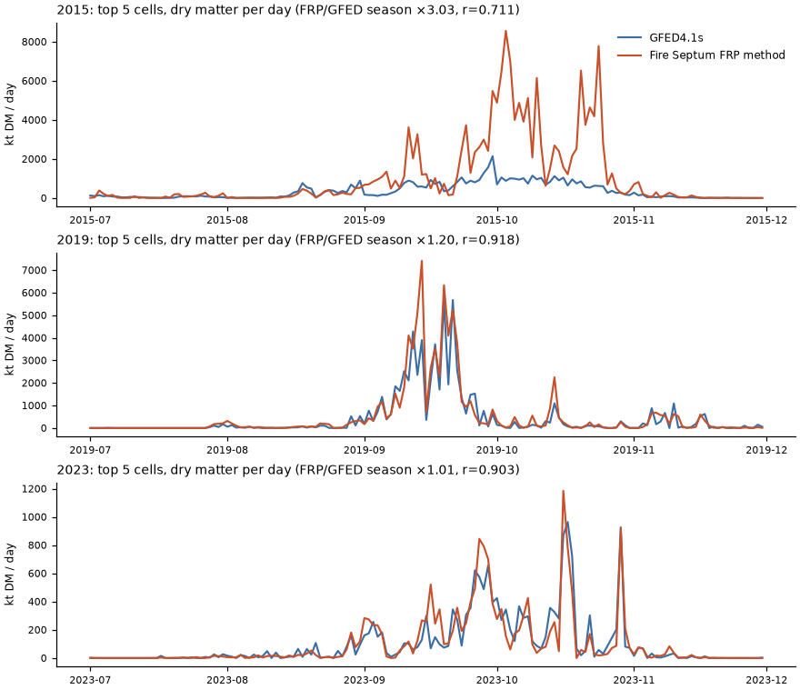

# Cross-check: the satellite emission number against GFED

Run on 24 October 2026 with `ml/rs/emissions_crosscheck.py`. Machine-readable results, including the daily series per cell: `data/validation/emissions-crosscheck.json`. Plot: `docs/img/emissions-crosscheck.png`. Tables below are printed by `ml/rs/make_tables.py` from that JSON.

## Question

Fire Septum's outcome card shows what satellites have already seen burn, using fire radiative power (FRP) from VIIRS (`src/sim/frp.ts`, README *Already released, by satellite*). Does that method give numbers of the right size, compared with independent fire-emission inventories, for the same places and days?

## Method

**Our method, ported to Python.** `ml/rs/emissions_crosscheck.py` copies `frp.ts` step by step:
- A pass is one satellite in one 10-minute bin. FRP is summed over the pass.
- Each pass is held until the next pass seen in the same area, for at most 12 h, to give fire radiative energy (FRE, MJ).
- Dry matter = FRE × the GFAS conversion factor for the cover (Kaiser et al. 2012, Table 2): peat 5.87, tropical forest 0.96, savanna 0.78, agriculture 0.29 kg/MJ.
- CO₂ and CO₂e use the app's factors: peat 464 g C/kg × 44/12 and 21 g CH₄/kg (IPCC 2013 Wetlands Supplement), other covers IPCC 2006 Vol. 4, Table 2.5, CH₄ GWP-100 = 27.
- Cover per detection, as in the app: peat where the Global Forest Watch peatland tile is opaque; elsewhere ESA WorldCover 2021, mapped like `landcover.ts` (`fuelFromCover`) and `frp.ts` (`coverOf`). A detection on water or built-up land takes the most common burnable class within about 500 m, like `coverAt`.

The "area" is a GFED 0.25° cell instead of the app's 6.4 km box. The holding rule is applied per cell.

**Detections.** NASA FIRMS VIIRS S-NPP country archive for Indonesia (keyless). Only type 0 (vegetation fire) with FRP > 0; volcanoes, static industrial sources and offshore detections are dropped. NOAA-20 and NOAA-21 are not used: the archive files used here are S-NPP only, and NOAA-20 starts in 2018.

**Cells.** For each season (1 July – 30 November, UTC), the 5 GFED cells in Indonesia with the most S-NPP detections. These contain the busiest 6.4 km fire boxes of each season. All 15 cells are on peat-dominated land in South Sumatra, Jambi and Central Kalimantan.

**GFED4.1s.** Monthly dry matter by source (`DM_PEAT`, `DM_DEFO`, `DM_SAVA`, …, kg m⁻² s⁻¹) times the GFED daily fractions, from the GEOS-Chem mirror of the GFED4.1s files (`http://geoschemdata.wustl.edu/ExtData/HEMCO/GFED4/v2023-03/`, keyless). GFED's own download server (`geo.vu.nl`) no longer serves these files. GFED CO₂ is dry matter times the GFED4 CO₂ factors by source (van der Werf et al. 2017): SAVA 1686, BORF 1489, TEMF 1647, DEFO 1643, PEAT 1703, AGRI 1585 g/kg. Cell areas are computed on a sphere.

**GFED5.1.** The gridded GFED5.1 files are only served over SFTP with a login, so they were not used. The keyless GFED5.1 summary table gives annual CO₂ by region. It is compared with our method summed over all of Indonesia for the whole year. Region EQAS (Equatorial Asia) also contains Malaysia, Brunei, Timor-Leste and Papua New Guinea, so it is slightly larger than Indonesia.

**What GFED is, per year.** In 2015 GFED4.1s is built from MODIS burned area, so it is independent of FRP. In 2019 and 2023 it is the "beta" version, scaled from MODIS active-fire detections by a per-cell factor calibrated on 2003–2016. So 2015 is the only truly independent comparison at cell level. GFED5.1 uses burned area, including small fires, for every year.

## Results

### Per cell, season 1 Jul – 30 Nov

| Year | Cell (centre) | VIIRS det. | Peat share | DM FRP method (kt) | DM GFED4.1s (kt) | Ratio | Daily r (Pearson / Spearman) | CO2 FRP (Mt) | CO2 GFED (Mt) | Peat DM FRP / GFED (kt) |
|---|---|---|---|---|---|---|---|---|---|---|
| 2015 | -2.875, 105.625 | 17,409 | 97% | 68,211 | 18,570 | 3.67 | 0.78 / 0.84 | 116.04 | 31.61 | 68,150 / 18,206 |
| 2015 | -2.625, 105.375 | 11,634 | 99% | 38,089 | 10,608 | 3.59 | 0.24 / 0.75 | 64.80 | 17.96 | 38,070 / 8,512 |
| 2015 | -1.875, 103.875 | 10,706 | 99% | 20,369 | 5,158 | 3.95 | 0.07 / 0.69 | 34.65 | 8.67 | 20,332 / 3,078 |
| 2015 | -3.375, 105.625 | 9,873 | 92% | 23,449 | 14,684 | 1.60 | 0.74 / 0.85 | 39.87 | 24.85 | 23,256 / 11,828 |
| 2015 | -1.875, 104.125 | 9,154 | 81% | 11,006 | 4,230 | 2.60 | 0.26 / 0.71 | 18.67 | 7.06 | 10,572 / 1,319 |
| 2015 | **5 cells pooled** | | | **161,123** | **53,250** | **3.03** | **0.71 / 0.90** | **274.04** | **90.15** | |
| 2019 | -1.625, 104.125 | 7,322 | 100% | 25,511 | 23,939 | 1.07 | 0.64 / 0.86 | 43.40 | 40.03 | 25,504 / 9,783 |
| 2019 | -3.125, 114.125 | 5,866 | 99% | 8,679 | 13,947 | 0.62 | 0.78 / 0.79 | 14.77 | 23.57 | 8,670 / 10,741 |
| 2019 | -3.125, 113.875 | 5,031 | 100% | 11,689 | 10,316 | 1.13 | 0.78 / 0.80 | 19.89 | 17.54 | 11,689 / 9,729 |
| 2019 | -1.625, 103.875 | 4,961 | 98% | 22,804 | 13,010 | 1.75 | 0.89 / 0.83 | 38.79 | 21.96 | 22,760 / 9,575 |
| 2019 | -2.375, 114.375 | 4,503 | 99% | 9,444 | 3,994 | 2.36 | 0.74 / 0.75 | 16.07 | 6.77 | 9,440 / 3,348 |
| 2019 | **5 cells pooled** | | | **78,127** | **65,205** | **1.20** | **0.92 / 0.91** | **132.91** | **109.86** | |
| 2023 | -3.375, 105.125 | 4,217 | 94% | 6,878 | 6,424 | 1.07 | 0.88 / 0.88 | 11.70 | 10.86 | 6,819 / 5,060 |
| 2023 | -3.375, 105.375 | 2,459 | 69% | 3,637 | 4,285 | 0.85 | 0.81 / 0.81 | 6.17 | 7.21 | 3,482 / 2,761 |
| 2023 | -2.625, 115.125 | 2,056 | 33% | 1,550 | 1,597 | 0.97 | 0.77 / 0.66 | 2.61 | 2.68 | 1,293 / 785 |
| 2023 | -3.375, 104.875 | 1,709 | 94% | 2,240 | 1,186 | 1.89 | 0.49 / 0.73 | 3.81 | 1.98 | 2,225 / 567 |
| 2023 | -2.625, 114.625 | 1,576 | 81% | 1,845 | 2,494 | 0.74 | 0.75 / 0.80 | 3.13 | 4.21 | 1,764 / 1,921 |
| 2023 | **5 cells pooled** | | | **16,151** | **15,985** | **1.01** | **0.90 / 0.91** | **27.42** | **26.95** | |

Mean daily bias of the pooled dry matter (FRP − GFED): 705 kt/day in 2015, 85 kt/day in 2019, 1 kt/day in 2023. The median daily ratio, on days when both are above zero, is 1.67, 1.14 and 0.99.



### All of Indonesia, whole year, against GFED5.1 (region EQAS)

| Year | VIIRS det. (all Indonesia, type 0) | Peat share | CO2 FRP method (Mt) | CO2e FRP method (Mt) | GFED5.1 EQAS CO2 (Mt) | Ratio |
|---|---|---|---|---|---|---|
| 2015 | 859,348 | 51% | 1,619 | 2,111 | 1,087 | 1.49 |
| 2019 | 424,521 | 50% | 816 | 1,064 | 524 | 1.56 |
| 2023 | 236,115 | 32% | 320 | 410 | 218 | 1.47 |

### The holding cap decides the size

| Year | Pooled DM ratio, hold cap 3 h | 6 h | 12 h (app default) |
|---|---|---|---|
| 2015 | 0.80 | 1.58 | 3.03 |
| 2019 | 0.33 | 0.63 | 1.20 |
| 2023 | 0.27 | 0.53 | 1.01 |

With one satellite, passes over a cell come about 12 h apart (around 13:30 and 01:30 local time), so almost every pass is held for the full cap. The total therefore scales almost linearly with the cap.

## What this says

1. **The timing is right.** On the busiest cells, daily dry matter from the FRP method follows GFED closely: pooled Pearson r = 0.71 (2015), 0.92 (2019) and 0.90 (2023), and Spearman r ≥ 0.90 every year. The method sees the right fire days.
2. **The size agrees to within a factor of 1 to 3, and errs on the high side.** Against GFED4.1s the pooled season ratio is 3.0 in 2015, 1.2 in 2019 and 1.0 in 2023. Against GFED5.1 for all of Indonesia it is 1.47–1.56 every year, even though EQAS covers more land than Indonesia.
3. **The 2019 and 2023 agreement is the weaker evidence.** In those years GFED4.1s is itself scaled from MODIS active fires, so both sides share part of their information. The only year with a burned-area GFED4.1s, 2015, gives the largest ratio (3.0). GFED5.1, which uses burned area every year, gives about 1.5.
4. **The likely reason the FRP number runs high is the holding rule, not the peat factor.** Holding a 13:30 FRP for 12 h assumes the fire stays at its afternoon strength all night. Flaming fire usually peaks in the afternoon, so this is an upper bound for flaming. A 6 h cap would bring 2015 to 1.6× GFED4.1s and 2019/2023 to about 0.5–0.6×. The truth is between the 6 h and 12 h numbers, and depends on how much the peat keeps smouldering at night.
5. **Peat smouldering points the other way.** Smouldering peat radiates little to the sky, so FRP sees less of it than burns. GFAS compensates with its large peat factor (5.87 kg/MJ), which was fitted so that GFAS matches burned-area inventories (GFED3.1) on average, not fire by fire. Our method uses that factor and so inherits the compensation. The two effects (holding too long, seeing too little smoulder) partly cancel, which is why the per-fire error stays wide.
6. **GFED itself is uncertain on peat.** GFED's peat burn depth is a model choice, as is the IPCC 353 t/ha default in our forecast. Agreement within a factor of 2 is about as close as independent inventories get to each other for Indonesian peat fires.

**Conclusion for the app.** The "already released, by satellite" number is a sensible order-of-magnitude estimate that tracks real fire days. It should be read as "within a factor of 2–3, probably high", not as a measurement. Two changes would make it more defensible:
- use all three VIIRS satellites (the app already does), which shortens the holds;
- add a diurnal shape or a shorter cap for daytime passes, and fit the cap against GFED5.1.

The README's caveat that the number is a floor on peat should be softened: at cell level, with 12 h holds, it is more often above GFED than below.

## GFAS

CAMS GFAS v1.2 is only distributed through the Copernicus Atmosphere Data Store, which needs a free account and API key. No `ADS_API_KEY` is configured here, so the comparison was not run. `ml/rs/gfas_crosscheck.py` does it when the key is set:

```bash
ADS_API_KEY=<key> uv run --project ml/rs python ml/rs/gfas_crosscheck.py
```

It reads the daily per-cell series from `data/validation/emissions-crosscheck.json`, downloads GFAS daily dry-matter and CO₂ fluxes for each season, sums them over the same 0.25° cells (0.1° cells assigned by centre) and writes `data/validation/gfas-crosscheck.json`. Our method uses the GFAS conversion factors, so agreement with GFAS mainly tests the holding rule and the cover assignment, not the factors. GFAS also uses MODIS FRP with its own gap-filling, not VIIRS.

## Caveats

- **One satellite.** S-NPP only. The app combines S-NPP, NOAA-20 and NOAA-21, which gives three times as many passes and shorter holds, so the app's number at the same place would be lower than the 12 h column above.
- **Cover maps are static and recent.** WorldCover is 2021 and the peat map is undated, so land that was forest in 2015 and burned may now be shrub. Peat-soil cells dominate the busiest cells (81–100% of detections in 13 of 15 cells), so the peat factor drives almost all of the total.
- **Grid mismatch.** GFED cell areas are computed on a sphere, not from GFED's own area file; the difference is well under 1%.
- **Daily fractions.** GFED distributes monthly totals over days using MODIS active fires. A day-by-day comparison therefore partly compares two active-fire products, even in 2015.
- **GFED5.1 gridded data were not used.** They are only available over SFTP with a login. The regional table is a coarse check: whole-year and slightly larger than Indonesia.

## Reproduce

```bash
uv run --project ml/rs python ml/rs/emissions_crosscheck.py   # ~15 min first time (downloads), cached afterwards
uv run --project ml/rs python ml/rs/make_tables.py            # prints the tables above
```

## References

- Kaiser J. W. et al. (2012). Biomass burning emissions estimated with a global fire assimilation system based on observed fire radiative power. *Biogeosciences* 9:527–554 (Table 2: conversion factors).
- van der Werf G. R. et al. (2017). Global fire emissions estimates during 1997–2016. *Earth System Science Data* 9:697–720 (GFED4s).
- Chen Y. et al. (2023). Multi-decadal trends and variability in burned area from the fifth version of the Global Fire Emissions Database (GFED5). *Earth System Science Data* 15:5227–5259.
- Schroeder W. et al. (2014). The New VIIRS 375 m active fire detection data product. *Remote Sensing of Environment* 143:85–96.
- IPCC (2013). *Wetlands Supplement*, ch. 2, Tables 2.6–2.7. IPCC (2006). *Guidelines*, Vol. 4, Table 2.5.
- Zanaga D. et al. (2022). ESA WorldCover 10 m 2021 v200. Gumbricht T. et al. (2017), tropical peat map, via Global Forest Watch.
